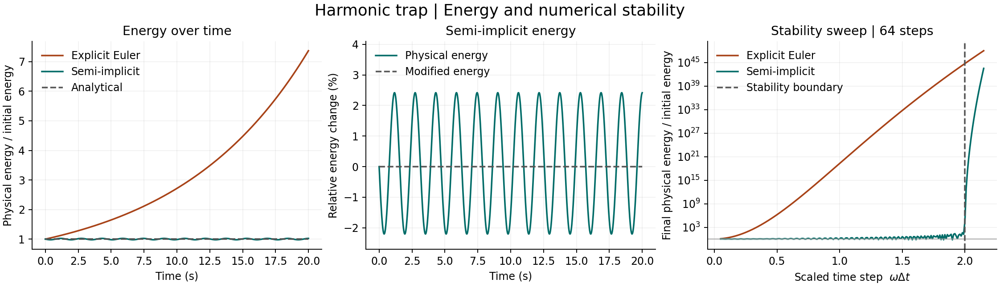
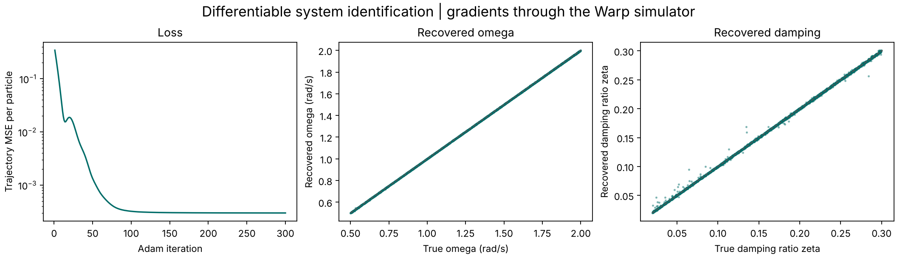

# Warp Trap Lab

A batched 3D particle simulation in NVIDIA Warp that compares explicit Euler and velocity-first semi-implicit Euler, then differentiates through the simulator to identify unknown physical parameters. Each unit-mass particle evolves independently in an isotropic harmonic trap. The same in-place Warp kernel integrates either method on the CPU or CUDA.

The central experiment sweeps 211 values of the dimensionless time step $s = \omega\Delta t$ and tests the predicted stability boundary at $s=2$. A second experiment checks why the semi-implicit trajectory can remain stable even when its physical energy oscillates. The method preserves a nearby quadratic energy in exact arithmetic.



## Measured results

The included run used Warp 1.19.0 on an Apple M5 CPU. With $\omega=2$ rad/s, $\Delta t=0.025$ s, and 800 steps, both methods passed their numerical checks.

| Check | Measured result |
| --- | ---: |
| Analytical solution's maximum relative energy change | $3.33\times10^{-16}$ |
| Explicit Euler final energy / initial energy | $7.37\times$ |
| Explicit Euler maximum relative error against its discrete energy law | $1.26\times10^{-6}$ |
| Semi-implicit maximum relative change in physical energy | $2.42\%$ |
| Semi-implicit maximum relative change in modified energy | $1.76\times10^{-6}$ |
| Observed order from the finest two time steps, explicit / semi-implicit | 1.036 / 1.011 |

At $s=1.90$, $2.00$, and $2.10$, semi-implicit Euler ended the 64-step sweep at $0.647\times$, $3.36\times10^4$, and $7.21\times10^{35}$ its initial energy, respectively. These finite-time samples illustrate bounded oscillation, growth at the boundary, and exponential instability above it. The boundary follows from the update matrix below.

The CPU benchmark timed 100 steps per repeat and used the median of five repeats. CUDA timing and parity require a CUDA host. The included reports contain CPU measurements.

| Particles | Explicit median | Semi-implicit median |
| ---: | ---: | ---: |
| 1,024 | 0.726 ms | 0.710 ms |
| 32,768 | 4.864 ms | 4.887 ms |
| 262,144 | 35.006 ms | 35.582 ms |

[Validation checks and metadata](results/cpu/validation.json) · [Energy traces](results/cpu/energy.csv) · [Stability sweep](results/cpu/stability.csv) · [Benchmark samples](results/cpu/benchmark.json) · [Throughput plot](results/cpu/benchmark.png)

## Differentiable system identification

The second half of the project runs the simulator in reverse. Every particle becomes a damped oscillator, $\dot v=-\omega^2x-2\zeta\omega v$, with its own unknown stiffness $\omega$ and damping ratio $\zeta$. The run generates noisy position observations from ground-truth parameters. It then recovers all 4,096 $(\omega,\zeta)$ pairs at once by differentiating a trajectory-matching loss through 150 unrolled semi-implicit steps with `wp.Tape` and updating with Adam. The parameters are optimized in log space so they stay positive. Each particle is independent, so one backward pass over the summed loss returns every particle's gradient.



| Check (4,096 particles, 150 steps, noise σ = 0.01) | Measured result |
| --- | ---: |
| Autodiff vs. central finite differences, worst relative error | $8.8\times10^{-3}$ |
| Trajectory MSE, initial to final (noise floor $3\sigma^2 = 3\times10^{-4}$) | 0.344 → $2.99\times10^{-4}$ |
| $\omega$ relative error, median / p95 | 0.044% / 0.17% |
| $\zeta$ relative error, median / p95 | 0.32% / 1.7% |

The final loss matches the measurement-noise floor, so the fit explains everything except the injected noise. Damping is harder to identify than stiffness because it only shows up as slow amplitude decay. Its tail error is correspondingly larger for lightly damped particles. This run used an x86-64 Linux CPU. [Report](results/cpu/sysid.json)

## Run locally

Use Python 3.11 or newer. For CUDA, check the driver and GPU requirements for the Warp wheel. [NVIDIA Warp installation guide](https://nvidia.github.io/warp/stable/user_guide/installation.html)

```bash
python3 -m venv .venv
source .venv/bin/activate
python -m pip install -r requirements.txt
python -m unittest discover -s tests -v
python -m warp_trap validate --device cpu --out runs/cpu
python -m warp_trap benchmark --device cpu --out runs/cpu
python -m warp_trap sysid --device cpu --out runs/cpu
```

On a host with a compatible NVIDIA GPU, run the CUDA validation first. That command exits with an error if Warp cannot find a CUDA device. The benchmark then runs the CPU and first CUDA device on that same host and reports per-method speedup at each size. The unit suite also runs a CPU/CUDA trajectory parity check when CUDA is available.

```bash
python -m warp_trap validate --device cuda:0 --out runs/cuda
python -m unittest discover -s tests -v
python -m warp_trap benchmark --device all --out runs/cpu-vs-cuda
```

The timing window starts after warmup, initialization, and device synchronization. It includes Python dispatch, one Warp kernel launch per step, integration, and a final synchronization. Array allocation, host/device transfers, and correctness readbacks are outside the window. The benchmark uses seeded initial states, fresh arrays per repeat, matching float32 workloads, and a separate throughput result for each integrator and batch size. Adjust the workload with `--sizes`, `--steps`, and `--repeats`. Benchmark speedup is the CPU median divided by the CUDA median.

## Model and predictions

The equations are $\dot{x}=v$ and $\dot{v}=-\omega^2x$. The exact solution is $x(t)=x_0\cos(\omega t)+(v_0/\omega)\sin(\omega t)$ and $v(t)=v_0\cos(\omega t)-\omega x_0\sin(\omega t)$. In continuous time the physical energy $E=(\|v\|^2+\omega^2\|x\|^2)/2$ is constant.

Both methods compute $v_{n+1}=v_n-\Delta t\,\omega^2x_n$. Explicit Euler updates position with $v_n$. Semi-implicit Euler uses $v_{n+1}$. In scaled coordinates $(\omega x,v)$, each Cartesian coordinate follows the corresponding two-by-two map.

$$
A_{\mathrm{explicit}} =
\begin{pmatrix}1&s\\-s&1\end{pmatrix},
\qquad
A_{\mathrm{semi}} =
\begin{pmatrix}1-s^2&s\\-s&1\end{pmatrix}.
$$

- **Explicit Euler.** $A^\mathsf{T}A=(1+s^2)I$, so $E_n/E_0=(1+s^2)^n$. Energy grows for every positive step.
- **Semi-implicit Euler.** The determinant is one and the trace is $2-s^2$. The eigenvalues form a unit-modulus conjugate pair for $0<s<2$. At $s=2$ the repeated eigenvalue $-1$ has only one eigenvector, so generic states grow linearly in amplitude. For $s>2$ one eigenvalue has magnitude greater than one, producing exponential growth for generic states.
- **Modified energy.** Direct substitution gives the invariant $\tilde E=E-(\Delta t\,\omega^2/2)(x\cdot v)$. For $0<s<2$ it is positive definite and satisfies $(1-s/2)E\leq\tilde E\leq(1+s/2)E$. This yields the tested upper bound $s/(1-s/2)$ on the absolute relative change in physical energy. The bound loosens as $s$ approaches 2.

The solver uses float32 Warp state. The analytical reference and energy diagnostics use float64 on the host. The convergence check halves the time step three times at fixed duration and compares numerical and analytical states in $(x,v/\omega)$ coordinates.
